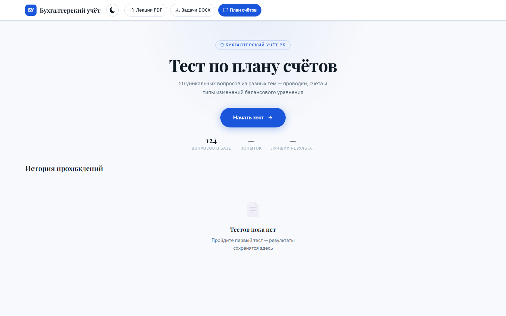

# Тест по плану счетов

Веб-тренажёр по бухгалтерскому учёту Республики Беларусь: проверка знания плана счетов, бухгалтерских проводок и изменений балансового уравнения.

**Открыть:** https://thefulum.github.io/accounting-quiz/



## О проекте

Тренажёр разработан по заказу преподавателя бухгалтерского учёта колледжа: для конкурса и для проверки знаний студентов на занятиях. Преподаватель сам пополняет и редактирует базу вопросов через страницу администратора, без участия разработчика.

## Возможности

- **Тест из 20 вопросов**, которые случайно выбираются из базы (сейчас 124 вопроса) так, чтобы охватить разные темы: не более трёх вопросов на тему.
- **Темы**: расчёты с контрагентами, заработная плата, производство и материалы, основные средства, капитал и финансовый результат, налоги, кредиты и другие.
- **Двойная проверка в каждом вопросе**: нужно выбрать правильный ответ и указать тип изменения балансового уравнения.
- **Ограничение по времени**: 20 минут на тест.
- **Результат с разбором**: правильные ответы и пояснения к каждому вопросу.
- **История прохождений** и лучший результат сохраняются в браузере.
- **Справочник плана счетов** с поиском прямо на сайте, ссылки на лекции и задачи.
- **Страница администратора**: добавление, редактирование и удаление вопросов. Изменения сохраняются в файл `questions.json` в этом репозитории через GitHub API, после чего сайт обновляется автоматически.
- Светлая и тёмная тема.

## Технологии

- HTML, CSS, JavaScript без фреймворков
- Bootstrap 5
- GitHub API для редактирования базы вопросов
- GitHub Pages для публикации

## Структура

```
index.html       главная: старт теста, история, справочник плана счетов
quiz.html        прохождение теста
result.html      результат и разбор ответов
admin.html       редактор вопросов
questions.json   база вопросов
js/              логика теста, главной страницы и редактора
```

## Запуск

Сайт статичный: откройте его через любой локальный HTTP-сервер. Для работы редактора вопросов нужен персональный токен GitHub с правом записи в репозиторий.

---

Автор — [Липовский Даниил](https://github.com/TheFulum)
